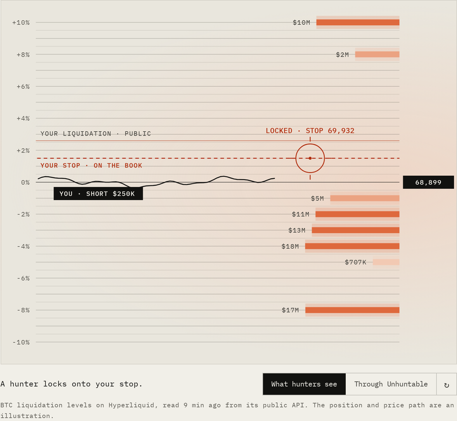
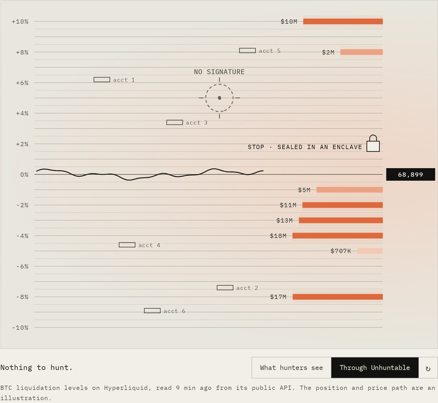
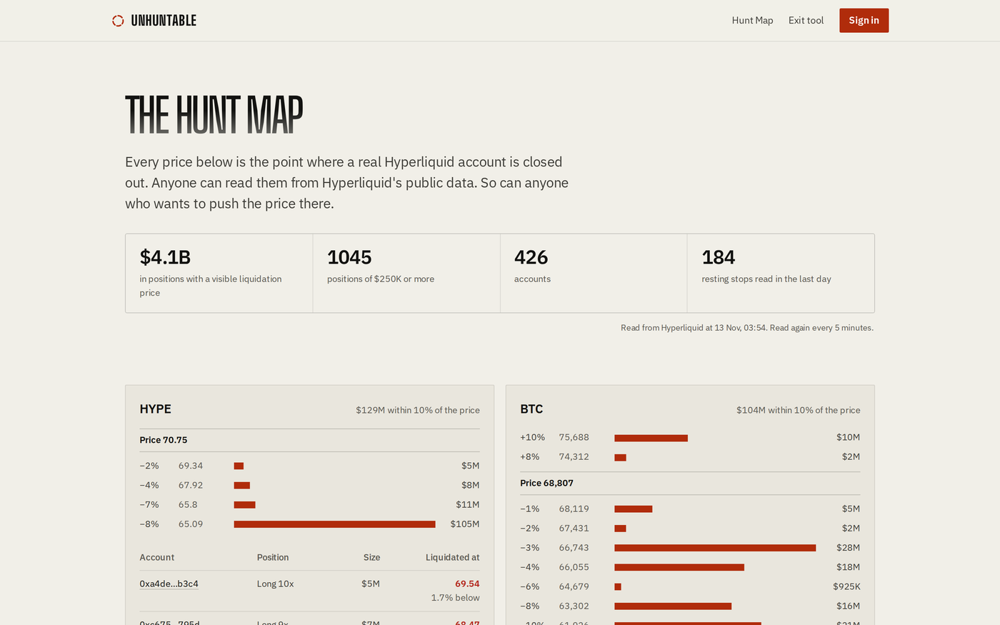
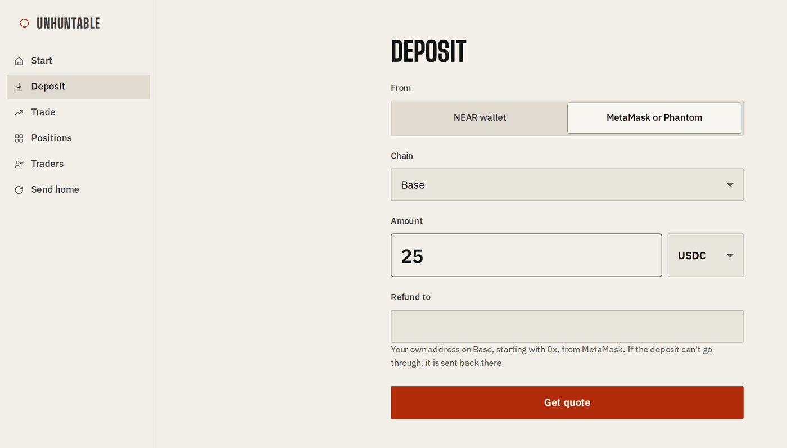
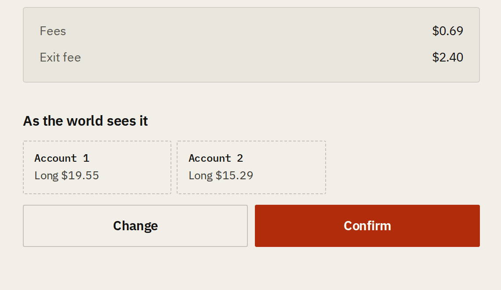
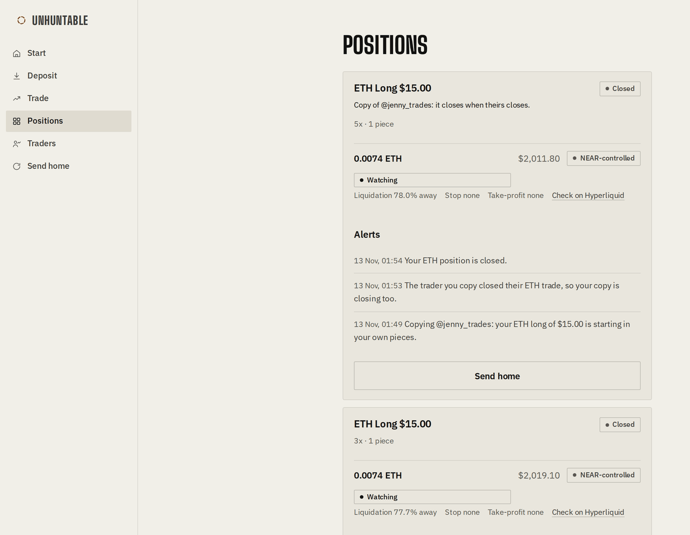
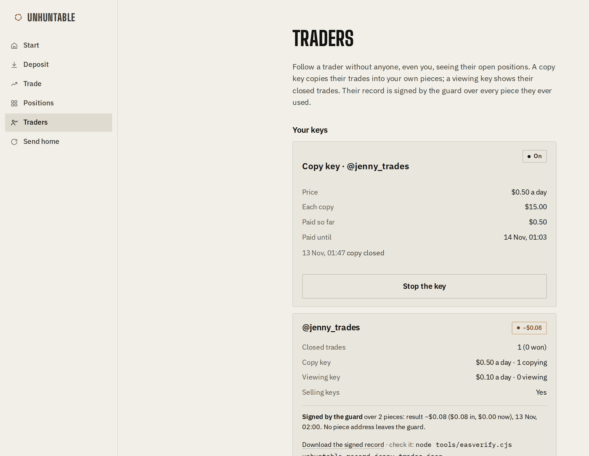
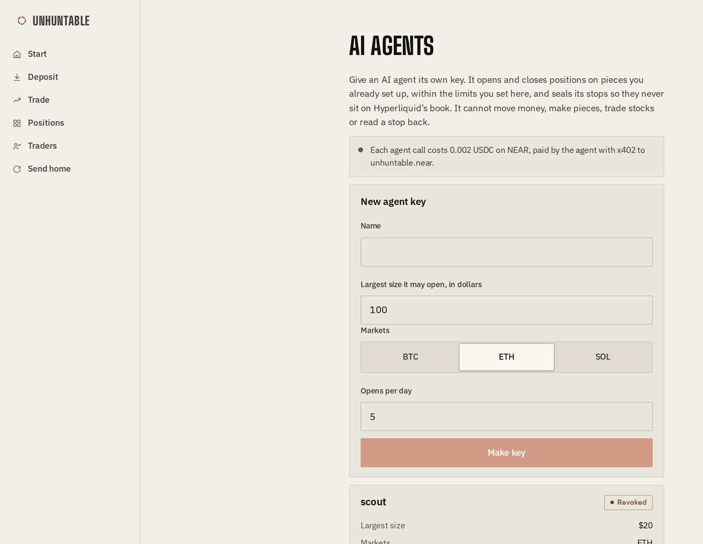
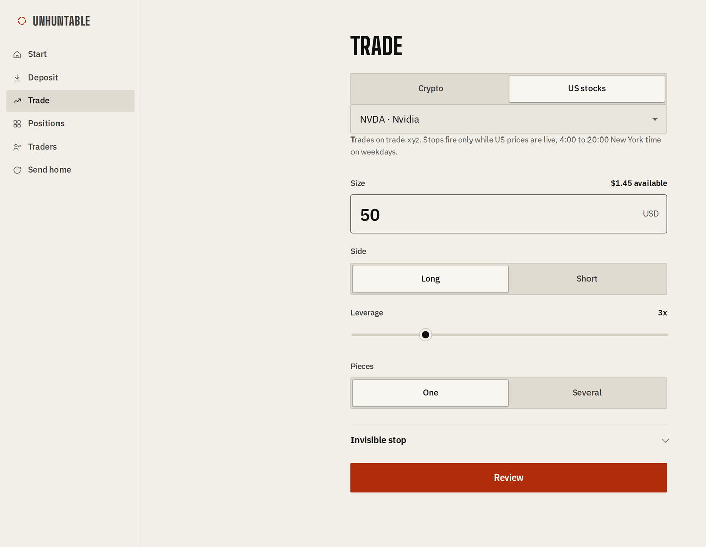
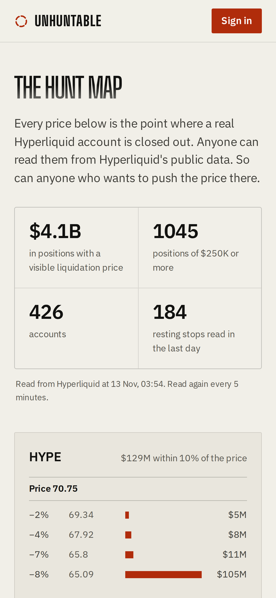

# Unhuntable

**Private perps on Hyperliquid and trade.xyz. Trade without being hunted, and sell keys that let others follow or copy your trading without ever seeing your positions. For traders, their followers and AI agents. Built on eleven parts of the NEAR stack.**

**Unhuntable hides the price that wipes you out, for people and for their agents.** Your position is split across accounts nobody can link, your stop is sealed where nobody can read it, and each piece's account is controlled by NEAR Chain Signatures, with no private key anywhere. Hunters have nothing to push the price to.

**Live app:** [tryunhuntable.site](https://tryunhuntable.site) · **Try a real trade:** [tryunhuntable.site/judge](https://tryunhuntable.site/judge/) (no sign-in) · **Hunt Map:** [tryunhuntable.site/hunt-map](https://tryunhuntable.site/hunt-map/) (no sign-in) · **Traders:** [tryunhuntable.site/traders](https://tryunhuntable.site/traders/) (no sign-in) · **Agents:** [`agent/`](agent/) (MCP server)

Built at **NEAR HACKATHON** · #NEARHackathon · **Demo video:** [watch on Clips](https://clips.agent-native.com/share/D99B2jDb4MFX) (3:22)

Tracks: **Privacy & Private AI** · **Unstoppable DeFi** · **AI Security & Defense** · **Agent Economy**

| What hunters see on Hyperliquid today | The same trade through Unhuntable |
| :---: | :---: |
|  |  |
| Your liquidation price is public and your stop sits on the book. A hunter locks on. | Small separate accounts, no stop on the book, the stop sealed in an enclave. Nothing to hunt. |

### Why it matters

- **Every Hyperliquid account is public.** Its size, the exact price that liquidates it and every stop resting on the book. Big positions are tracked by bots and dashboards, and the price is pushed to the levels everyone can see. The [Hunt Map](https://tryunhuntable.site/hunt-map/) shows them live.
- **near.com hides your name, not that price.** Its perps trade on Hyperliquid too, where every account's size and wipe-out price are public. Hunters do not need your name. Unhuntable removes the level itself: no big position to find, no stop on the book.
- **Private trading you can sell.** On a public exchange, letting people follow you means showing your positions to the people most able to hunt them. Here a trader sells keys instead: **copy keys**, which copy their trades into each follower's own unlinkable pieces, and **viewing keys**, which show closed trades only. Followers pay day by day by private transfer on NEAR Intents, and the trader's record is signed by the guard over every piece they ever used. Nobody, followers included, ever sees an open position. [Followers](#for-followers-private-trading-you-can-sell)
- **Agents have it worse.** Their wallets are public, they trade on schedules, and a prompt injection can talk them into giving away their stop. Here the stop is sealed on the agent's own machine and no tool can read it back.
- **Proven on mainnet with real money:** [a sealed stop firing on an NVDA short](https://app.hyperliquid.xyz/explorer/tx/0xe3658df9d0c075c3e4df04488de8bc02021800df6bc39495872e394c8fc44fae), [NEAR's MPC network signing for a Hyperliquid account with no private key](https://nearblocks.io/txns/86qJbTWkiXwXsKfCCWqK63yLanzvkbxikMj1R4HfufVd), and [an AI agent paying for a call with x402](https://nearblocks.io/txns/7VcZWHJzgrauZaY6irWh1BiHGcr7kDch92UG69MFvMBD).
- **The answer NEAR's founder pointed to.** In [NEP discussion #531](https://github.com/near/NEPs/issues/531), Illia Polosukhin notes that users spread their activity over many separate accounts to keep it apart, and that the answer lives in the application layer. Unhuntable is that answer for perps: the separate accounts are made and funded for you, from your one NEAR account.

### See it

Real screens from the live app at [tryunhuntable.site](https://tryunhuntable.site), with real money on mainnet.

| | |
| :---: | :---: |
|  |  |
| **The Hunt Map.** Billions in real positions, with the exact prices that wipe them out, read from Hyperliquid's public API. This is the problem. | **Deposit from any chain.** NEAR, Ethereum, Base, Arbitrum or Solana. The money lands in a private balance on NEAR Intents. |
|  |  |
| **Before you confirm, see what the world will see.** One trade becomes separate small accounts, each controlled by NEAR Chain Signatures with no private key anywhere. | **A follower's copy.** It opened in the follower's own piece minutes after the trader's, and closed when the trader closed. The follower never saw the trader's position. |
|  |  |
| **Sell keys to your trading.** Copy keys and viewing keys, paid day by day by private transfer. The record is signed by the guard over every piece the trader used. | **AI agents get the same protection.** Their own key and limits, over MCP, each call paid in USDC on NEAR with x402. No agent can move money or read a stop back. |
|  |  |
| **US stocks on trade.xyz.** NVIDIA, the Nasdaq-100 and more, with the same split and sealed stops. | **Works on a phone.** |

[See it](#see-it) · [For judges](#for-judges-start-here) · [How it works](#how-it-works-in-short) · [Three doors](#three-doors-one-protection) · [NEAR stack](#eleven-parts-of-the-near-stack-each-doing-real-work) · [Mainnet proof](#what-ran-on-mainnet-with-real-money) · [Go deeper](#go-deeper)

---

## For judges, start here

A few minutes, no wallet and no money needed:

1. **Open the [Hunt Map](https://tryunhuntable.site/hunt-map/).** Real Hyperliquid accounts and the exact prices that liquidate them, read from Hyperliquid's public API every 5 minutes. This is what every trader is exposed to today.
2. **Open three mainnet transactions.** [A sealed stop firing on an NVDA short](https://app.hyperliquid.xyz/explorer/tx/0xe3658df9d0c075c3e4df04488de8bc02021800df6bc39495872e394c8fc44fae), [NEAR's MPC network signing for a Hyperliquid account with no private key](https://nearblocks.io/txns/86qJbTWkiXwXsKfCCWqK63yLanzvkbxikMj1R4HfufVd), and [an AI agent paying for a call with x402](https://nearblocks.io/txns/7VcZWHJzgrauZaY6irWh1BiHGcr7kDch92UG69MFvMBD).
3. **Check an AI hunt yourself.** We sent an attacker AI, running in a NEAR AI Cloud TEE, after three of our own mainnet pieces. From a clone of this repo, with no account, `cd tools && npm install --no-package-lock && cd .. && node tools/check-ai-hunt.cjs docs/proof/ai-hunt-mainnet.json` checks that its answer came from that enclave: it prints three `yes` lines and the hunter's answer ([what it found](docs/ai-hunter.md#proof-run-on-mainnet)).
4. **Open a real trade yourself.** At [tryunhuntable.site/judge](https://tryunhuntable.site/judge/), pick BTC, ETH or SOL, long or short. No sign-in. A real $15 position opens on Hyperliquid at 2x from our demo account, on a piece controlled by NEAR Chain Signatures. Your stop is sealed in your browser and only the guard can open it. The page shows what Hyperliquid tells everyone about the piece: no stop on the book. It closes by itself after 3 minutes, or when you press Close. No wallet and no money needed, and nothing on that page can move money. [How it is paid for](#try-a-real-trade-how-it-is-paid-for)
5. **Run the tests.** 604 tests across the guard, the signer contract, the client, the server, the MCP server and the app, plus browser tests at phone and desktop size, all in CI: [Check it yourself](docs/check-it-yourself.md).

---

## Try a real trade: how it is paid for

[tryunhuntable.site/judge](https://tryunhuntable.site/judge/) lets anyone, with no sign-in and no wallet, open one real trade on Hyperliquid through the same path every Unhuntable trade takes.

- **Whose money.** It trades from Unhuntable's own demo account, the follower account that holds a copy key to `@jenny_trades`. Its piece is controlled by NEAR Chain Signatures and holds about $11.60 of our own USDC on Hyperliquid, left on it by its earlier copy trade. We funded that account ourselves: NEAR swapped to USDC, deposited through the app into its private balance on NEAR Intents, then sent privately to the piece.
- **Nothing moves to open it.** A piece that already holds enough from its last trade trades on that money, so no transfer is sent and the trade opens in seconds. This is the same rule every user's reused piece follows.
- **What a trade costs us.** $15 at 2x on BTC, ETH or SOL. Hyperliquid's fees are about 1.4 cents a trade. The price can only cost what the stop allows: the page seals a stop 1%, 2% or 3% away, and the trade closes by itself after 3 minutes, or 90 seconds after it opens if no stop was sealed. So one trade costs at most about 45 cents, and usually a cent or two.
- **Limits.** One trade at a time, 3 minutes each, and 40 a day. If the piece ever holds too little, the page says so before anyone presses anything. The page takes only a market and a side: no size, no leverage, no address and no amount, so nobody can move money through it. Moving the piece's money needs the demo account's own 12 words.
- **Topping it up.** If the piece runs low, we send it more by private transfer from our own private balance, the normal funding path. Until then the page says it cannot open a trade.

---

## Eleven parts of the NEAR stack, each doing real work

| | What it does in Unhuntable | Proof on mainnet |
| --- | --- | --- |
| **NEAR Chain Signatures** | `unhuntable.near` asks `v1.signer` to sign Hyperliquid actions for a piece, so the piece's Hyperliquid account has no private key anywhere | [`unhuntable.near`](https://nearblocks.io/address/unhuntable.near) · [approve-agent tx](https://nearblocks.io/txns/86qJbTWkiXwXsKfCCWqK63yLanzvkbxikMj1R4HfufVd) · [the account it controls](https://app.hyperliquid.xyz/explorer/address/0x35c99eff31255e9ac3fc2a3c6e4dd70cb026b02a) |
| **OutLayer TEE (Intel TDX)** | Runs the guard: sealed stops, one agent key per piece, up to seven price sources, the defence ladder, and each trader's signed record over every piece they ever used | Sealed-stop trade: public order list `[]` while open, then a reduce-only close |
| **NEAR AI Cloud (TEE inference)** | Runs the NEAR AI Hunter: an attacker AI that starts from one of your pieces and tries to find the others in Hyperliquid's public data, with the enclave's signature over the exact question and answer | [Mainnet hunt on three real pieces](docs/ai-hunter.md#proof-run-on-mainnet): 1 named, 0 strangers; the signed receipt checks with one command |
| **trade.xyz (US stocks on Hyperliquid)** | 12 stock and index markets, isolated margin, money moved onto trade.xyz and back by Chain Signatures, stops that need two prices from outside the book | [move in](https://nearblocks.io/txns/8LzpGyN9kKpDwMmYKihG1MXXbgHFbs9H3E9Ci7w1jL6Z) · [stop fired](https://nearblocks.io/txns/6ewnHXXtwTjBvqdEqYdDkoVc3oE3ew2b6prZ5MAVCz4c) · [move back](https://nearblocks.io/txns/CALA24Gya1fLd8No2wzukUSM8cQ29eaBAUActpFLVGvc) |
| **x402 on NEAR + PingPay (AI agents)** | Each agent call is paid in USDC on NEAR with a NEP-366 delegated `ft_transfer`, settled by our relayer before the call runs; or from six other chains through PingPay Agent Pay, settled to `unhuntable.near` through NEAR Intents | [paid agent call](https://nearblocks.io/txns/7VcZWHJzgrauZaY6irWh1BiHGcr7kDch92UG69MFvMBD) · [PingPay call settled to `unhuntable.near`](https://nearblocks.io/txns/GzuVd2giEu3VJ6LpeKHZfw7rFG8jatkpJbqJ5ZyACkP3) |
| **NEAR Intents (Confidential)** | Holds your private balance, funds each piece with no public link between pieces, and pays for follower keys by private transfer from one private balance to another | 2.5 USDC sent privately to a piece, arriving as 2.178894 USDC |
| **1Click** | Deposits from any chain, and pays out to Hyperliquid through a shared payer used by thousands of accounts | [15 USDT in from BNB Chain](#what-ran-on-mainnet-with-real-money); ~2,000 shared-payer sends to 991 accounts in 12 hours |
| **Aurora Intents** | A second private way in, straight to a piece's Hyperliquid account, with our 6 basis point integrator fee | 2 USDC from Arbitrum landed as 1.6827 USDC, fee applied |
| **OutLayer VRF** | Draws piece sizes, entry times and stop jitter, with proofs anyone can check | Each plan stores its VRF output and proof |
| **OutLayer custody + on-chain policies** | Your wallets, under policies owned by **your** NEAR account that our server cannot change | Policies stored by the owner's Meteor wallet and read back from chain before money moved |
| **Sputnik DAO (treasury mode)** | A piece handed to a DAO moves only on a passed vote: `unhuntable.near` signs for it only when the DAO calls | On NEAR testnet: [proposal passed, NEAR signed for the piece's account](docs/treasury.md#proof); the same code runs on mainnet `unhuntable.near` |
| **NEAR wallets (NEP-413)** | Sign-in, the pieces key, every policy approval | Meteor on mainnet; HOT and MyNearWallet supported |
| **EAS** | Signed track records from the guard, totals only: one for all pieces, one per trader for Followers | Verifies with the official EAS SDK |
| **Security work for OutLayer** | Found and reported a flaw that leaked call inputs from public records | [out-layer/outlayer#35](https://github.com/out-layer/outlayer/issues/35) |

---

## How it works, in short

1. **Sign in with your NEAR wallet.** Your browser makes 12 words that only you hold. Every key Unhuntable uses for you comes from them.
2. **Deposit from any chain.** The money lands in your private balance on NEAR Intents.
3. **Open a trade.** Pick BTC, ETH, SOL or a US stock on trade.xyz, then size and leverage. A big position is split into 2 to 12 separate Hyperliquid accounts, each funded on its own from your private balance, so nobody can tie them together.
4. **Set your stop.** Your browser seals it into a box only the guard can open. It never goes on Hyperliquid's book, so there is no level for anyone to hunt.
5. **The guard watches.** It runs inside an OutLayer TEE, checks prices every 2 minutes, fires your stop only when independent prices agree, and cuts size before liquidation. It can trade, but Hyperliquid refuses it if it tries to move money.
6. **Go home.** Your own keys sign the money back to your private balance through NEAR Chain Signatures. If we ever disappear, the exit tool brings it home from your 12 words alone.
7. **Or hand it to your agent.** Give an AI agent its own key with limits on the Agents screen. It trades through the same pieces with the same sealed stops, and pays for each call itself.
8. **Or follow a trader.** Buy a copy key and their crypto trades are copied into your own pieces; buy a viewing key and you see their closed trades. Nobody, you included, ever sees their open positions.

[Every step in detail](docs/how-it-works.md)

---

## Three doors, one protection

### For DeFi traders

- **Crypto and US stocks.** BTC, ETH and SOL on Hyperliquid; NVDA, TSLA, AAPL, MSFT, GOOGL, AMZN, META, AMD, MU, INTC, XYZ100 and SP500 on trade.xyz. [An NVDA short opened](https://app.hyperliquid.xyz/explorer/tx/0xdfdd58cd4df862ffe15704488de26802050700b2e8fb81d183a604200cfc3cea) with an empty public order list, and [its sealed stop closed it](https://app.hyperliquid.xyz/explorer/tx/0xe3658df9d0c075c3e4df04488de8bc02021800df6bc39495872e394c8fc44fae).
- **No big position to find.** A whale-size position is split into 2 to 12 accounts, each funded on its own from a confidential balance on NEAR Intents, with sizes and entry times drawn from a VRF anyone can check.
- **Stops nobody can read.** Your browser seals the stop into a box only the guard can open. The guard runs in an OutLayer TEE and fires a reduce-only close only when independent prices agree; for stocks, two of them must come from outside the trade.xyz book. Nothing rests on the book until the moment it fires.
- **A guard that defends but cannot steal.** It cuts size on a ladder before liquidation, and with auto-refill on, tops the piece back up from your private balance within a daily limit you set. It trades with agent keys, and Hyperliquid refuses any transfer an agent signs; [we tried it on mainnet](#what-ran-on-mainnet-with-real-money).
- **Accounts with no private key.** Each piece's Hyperliquid account is controlled by NEAR Chain Signatures through [`unhuntable.near`](https://nearblocks.io/address/unhuntable.near), which signs only what that piece's own key approved. We could not move your money even if we wanted to.
- **Money in from any chain, with no trail.** Deposits through 1Click or Aurora Intents land in a confidential balance on NEAR Intents, and every piece is funded through the same shared payer that funds thousands of unrelated Hyperliquid accounts.
- **See yourself as hunters do.** Hunter's View puts each of your positions beside what Hyperliquid's public API shows for it: separate small accounts, no stop on the book. The public [Hunt Map](https://tryunhuntable.site/hunt-map/) shows what everyone else exposes: the liquidation price of every large position held by Hyperliquid's biggest accounts.
- **Send an AI hunter after yourself.** One tap sends an attacker AI, running in a NEAR AI Cloud TEE, after your own position: it starts from one piece and hunts for the rest in Hyperliquid's public data. You see what it named against the truth and against chance, with NEAR AI's enclave signature over the exact question and answer: [NEAR AI Hunter](docs/ai-hunter.md).
- **Teams and DAOs.** A piece can be handed to a DAO, and then its money moves only on a passed vote: [treasury mode](docs/treasury.md), proven with a Sputnik DAO.
- **Leave without us.** The exit tool brings your money home from your 12 words alone, even if our servers are gone.

### For AI agents

Agents get hunted more than people: their wallets are public, they trade on schedules, and a prompt injection can talk them into giving away their stop.

- **Their own key, your limits.** On the Agents screen you make a key for each agent with its largest size, its markets and its opens per day. The key is shown once and stored only as a hash.
- **A stop the agent cannot leak.** The MCP tool seals the stop on the agent's own machine into boxes only the guard can open. No tool reads it back, so a hostile prompt finds nothing to give away.
- **No way to move money.** The agent opens and closes on pieces you set up. Making pieces and moving money need your 12 words, which never leave your browser.
- **Pays for every call itself, in USDC on NEAR.** Each call is paid with x402: the agent signs a NEP-366 delegated `ft_transfer`, our relayer settles it on NEAR before the call runs, and a call the limits refuse costs nothing. [A paid agent call on mainnet](https://nearblocks.io/txns/7VcZWHJzgrauZaY6irWh1BiHGcr7kDch92UG69MFvMBD), 4.5 seconds [end to end](https://nearblocks.io/txns/6XQ9FdGdfuhGYJcinGyHedhqoBCvxorQ1figfR2RAdaL).
- **Or pays from another chain, through PingPay.** The same x402 challenge also offers PingPay Agent Pay: USDC on NEAR, Base, Ethereum, Arbitrum or Solana, NEAR, or Bitcoin. Ping quotes a one-time NEAR Intents deposit address, the agent deposits, and 0.2 USDC settles to `unhuntable.near` before the call runs. A deposit pays for one call only, and a payment still settling is resumed with the same proof, never paid twice.

### For followers: private trading you can sell

A trader sells keys so others can follow or copy their trading. On a public exchange that would mean showing your positions, which is exactly what hunters want. Here nobody, key holders included, ever sees an open position.

- **A copy key copies the trades, not the targets.** Each crypto trade the trader opens is copied a few minutes later into the follower's own pieces: same market, side and leverage, the follower's own size, split and timed by the follower's own random draw. The copy closes when the trader's closes. The follower sees their own copy, never the trader's position, stop or accounts, so there is nothing to leak or hunt.
- **Followers cannot be traced to the trader, or to each other.** Every copy starts at its own random time and is funded on its own, like any other position. There is no crowd of followers entering at one price.
- **A viewing key shows closed trades only.** Entry, exit and result, once a trade is over. A closed trade cannot be hunted or front-run.
- **Paid day by day, privately.** Buying a key is one wallet approval: your private balance's lock now lists that trader. Each day the key is on, our server sends the price by a private transfer on NEAR Intents' confidential shard, from your private balance to the trader's. The lock lets it pay no one else. Stop the key and the payments stop. The trader never learns who you are.
- **A record nobody can pick from.** Every piece is registered with the guard under its owner's tag the first time it trades, and a tag can never be added later. On request the guard sums every piece under a trader's tag from Hyperliquid, inside its TEE, and signs the totals as an EAS attestation. No address leaves the guard, and no losing piece can be left out.
- **Agents can follow too.** An agent lists traders, reads the closed trades of traders its owner holds a key to, and asks its owner for a key, which waits for the owner's approval in the app.

[Followers in detail](docs/followers.md)

---

## What ran on mainnet with real money

All of these are observed results on NEAR, NEAR Intents, OutLayer and Hyperliquid mainnet with small amounts, except the one row marked testnet.

| What we did | What happened |
| --- | --- |
| A full trade in the live app from our own NEAR wallet, recorded for the demo video | 25 USDC deposited from a NEAR wallet into the private balance. A $35 ETH long at 5x, split into 2 NEAR-controlled pieces, opened at 2011.0 and 2013.7 while Hyperliquid showed two unrelated accounts and no orders. Closed, then both pieces' money was signed home by NEAR's MPC network: $20.87 back in the private balance. The gap is Hyperliquid's new-account fee and routing, about $1.20 a piece, plus the trade. |
| The trader sold keys as `@jenny_trades`; a second account bought a copy key | One wallet approval, then $0.50 for the day went by private transfer from the follower's private balance to the trader's. The trader's ETH long was copied into the follower's own piece, which opened at 2011.8 minutes after the trader's. When the trader closed, the copy closed too. The follower never saw the trader's position, and the trader card then showed one follower and $0.50 earned. |
| Opened trades from the [try-a-trade page](#try-a-real-trade-how-it-is-paid-for) with no wallet | A $15 ETH long at 2x opened in about 10 seconds on the demo account's piece with no transfer, the stop was sealed in the browser, and the guard closed it 10 seconds later, for 1.4 cents. A short held for 45 seconds showed Hyperliquid's public view of the piece as "Short $14.88, liquidation 3,419, no orders". |
| Deployed the signer contract as `unhuntable.near` | Running on NEAR mainnet with `v1.signer` and Hyperliquid mainnet; no owner, no admin methods. |
| Registered a piece key and asked NEAR for its Hyperliquid account | `v1.signer` derived the account from `unhuntable.near` and the key; it was the same account we computed before the contract existed. |
| Funded that piece privately: 2.5 USDC from a confidential balance | Arrived as 2.178894 USDC on the piece's Hyperliquid account. |
| The piece key approved the guard's agent; the contract asked NEAR to sign | NEAR's MPC network signed in 6.5 seconds for 0.0086 NEAR. Hyperliquid answered `ok` and lists the guard's key as that account's agent. |
| The guard opened a 5x long of 0.0047 ETH on that piece and sealed a stop | Filled at 2244.0. Hyperliquid's public order list for the account was empty (`[]`) while the position was open. |
| The sealed stop was moved above the price and the guard ticked | The stop fired as a reduce-only close at 2243.6, with 7 of 7 price sources agreeing. A second tick fired nothing. The whole trade cost about one cent. |
| Moved a NEAR-controlled piece's 2.16 USDC onto trade.xyz | `unhuntable.near` asked NEAR to sign a `sendAsset` from the piece to itself; [signed in 8.8 seconds](https://nearblocks.io/txns/8LzpGyN9kKpDwMmYKihG1MXXbgHFbs9H3E9Ci7w1jL6Z), Hyperliquid answered `ok`. |
| The guard opened a 6x isolated short of 0.06 NVDA on trade.xyz and sealed a stop | Filled at 178.10 with 4 of 4 stock price sources agreeing. The account's public order list was empty (`[]`) while the position was open. |
| The sealed stop was moved below the price and the guard ticked | [The stop fired](https://nearblocks.io/txns/6ewnHXXtwTjBvqdEqYdDkoVc3oE3ew2b6prZ5MAVCz4c) as a reduce-only close at 178.22. A second tick fired nothing. The piece then moved its money back from trade.xyz through NEAR. The whole trade cost under one cent. |
| An AI agent called the live site through the MCP server, paying with x402 | [0.002 USDC moved](https://nearblocks.io/txns/7VcZWHJzgrauZaY6irWh1BiHGcr7kDch92UG69MFvMBD) from the agent's own NEAR account to `unhuntable.near` in a delegated `ft_transfer` our relayer submitted; the call ran after the payment settled. A [second paid call](https://nearblocks.io/txns/6XQ9FdGdfuhGYJcinGyHedhqoBCvxorQ1figfR2RAdaL) took 4.5 seconds end to end. |
| The same agent tried to open above its size limit, and with no ready piece | Both refused before payment; the agent's USDC balance shows only the two paid calls. |
| Asked the contract to sign the same request twice (NEAR testnet) | Refused: "the piece key did not sign this action". |
| Deposited 15 USDT from BNB Chain into an OutLayer wallet | Arrived as 14.978224 USDC in the wallet's NEAR Intents balance, then moved into its confidential balance. |
| Moved 3 USDC from a confidential balance to a piece's own Hyperliquid account | Arrived as 2.678831 USDC in the piece's perp account in under 3 minutes, sent by 1Click's shared payer, which made about 2,000 sends to 991 different accounts in the same 12 hours. |
| The piece's own wallet approved the guard's agent key | Hyperliquid answered `ok`. |
| The guard set leverage and opened a long of 0.0045 ETH | 7 of 7 price sources agreed; filled at 2266.7. |
| A sealed stop was set, then one guard tick ran | The stop fired once: a reduce-only close filled at 2266.6. A second tick reported nothing left to fire. No stop order ever sat on the book. |
| The guard's agent key tried to send 1 USDC out of the piece | Hyperliquid refused it: an agent's transfer counts as the agent's own empty account. The piece's balance did not change. |
| Sent 0.05 USDC by private transfer from one confidential balance to another, locked one | Arrived in about 10 seconds, all of it. The transfer has no public NEAR transaction, and both wallets' public NEAR Intents balances stayed at zero: the money exists only in the two private balances. A locked balance receives from anyone; it only limits whom it pays. |
| The guard signed a track-record proof | An EAS off-chain attestation with totals only (2 pieces, equity, net deposits, PnL). It verifies with the official EAS SDK and recovers the guard's key as signer. No address leaves the guard. |
| We sent the NEAR AI Hunter after three of our own pieces | Starting from one, among 15 accounts the same 1Click payer funded, the model in NEAR AI's TEE named 1 account: ours, the piece that ran the same $10 test loops. It missed the NEAR-controlled piece and named no stranger. Its enclave signed the question and answer; [the receipt checks](docs/ai-hunter.md#proof-run-on-mainnet). |
| We attacked our own piece with public data only | Funding origin, amount fingerprint, agent reuse and the private withdraw's public status: **not linked**. Input recovery from OutLayer's public call record: **linked**, before we sealed every call. **Not linked** after. ([details](docs/security.md#attacks-we-ran-on-our-own-pieces)) |

---

## Go deeper

| Page | What it covers |
| --- | --- |
| [Built on NEAR](docs/built-on-near.md) | Chain Signatures and `unhuntable.near`, the OutLayer TEE guard, NEAR Intents, Aurora Intents, NEAR wallets |
| [US stocks on trade.xyz](docs/us-stocks.md) | Markets, money moved by Chain Signatures, stops that need prices from outside the book, the NVDA run step by step |
| [AI agents](docs/ai-agents.md) | Agent keys and limits, the MCP server, x402 payments in USDC on NEAR |
| [Followers](docs/followers.md) | Copy keys and viewing keys, private daily payments, the guard-signed record per trader |
| [The Hunt Map and Hunter's View](docs/hunt-map.md) | How the map is collected and what it counts; your position as the public sees it |
| [NEAR AI Hunter](docs/ai-hunter.md) | An attacker AI in a NEAR AI TEE hunts your pieces; what it sees, how it is scored, the signed proof |
| [How it works](docs/how-it-works.md) | The life of one position, the architecture, prices and stops, the defence ladder, engineering decisions |
| [Security and privacy](docs/security.md) | Who could cheat and why they cannot, who sees what, the attacks we ran on our own pieces, the flaw we found for OutLayer |
| [Treasury mode](docs/treasury.md) | Pieces handed to a DAO: money moves only on a passed Sputnik DAO vote |
| [Leave without us](docs/leave-without-us.md) | Bringing your money home from your 12 words alone |
| [Fees and revenue](docs/fees.md) | The Aurora integrator fee, x402 agent calls, the Hyperliquid builder fee |
| [Check it yourself](docs/check-it-yourself.md) | Every test suite, one command each |

---

## Repo map

| Folder | What it is | Tests |
| --- | --- | --- |
| `guard/` | The guard: a Rust WASI program for OutLayer. Decisions are pure functions in `src/lib.rs`. | 44 |
| `client/` | TypeScript: sealed boxes, guard client, position planner, fill savings, pieces key, Hyperliquid signing, Chain Signatures pieces, NEAR relay, exit logic | 181 |
| `server/` | API, SQLite, jobs, NEAR sign-in, OutLayer wallet client, Chain Signatures relay, money flows, Hunt Map collector, Hunter's View, NEAR AI Hunter, PingPay route, Followers, try-a-trade page | 267 |
| `signer/` | NEAR contract `unhuntable.near`: Hyperliquid accounts controlled by Chain Signatures, signing only what each piece key approved | 16 |
| `contract/` | NEAR records contract: public, checkable records (hashes, amounts, treasury settings) and never an address that could tie pieces together | 18 |
| `agent/` | MCP server for AI agents: open, sealed stop, status, close, traders, closed trades, ask for a key; pays each call with x402 in USDC on NEAR or through PingPay | 13 |
| `web/` | Phone-first static web app with a strict CSP | 65 unit + Playwright at two screen sizes |
| `exit/` | Leave-without-us tool: one HTML page or a CLI | in `client/` |
| `attacks/` | Linking attacks with public data only | |
| `tools/` | EAS proof check and its reference, NEAR AI Hunter receipt check | |
| `scripts/` | Repo checks run in CI | |

CI runs every folder's tests, rebuilds the exit page and checks it matches, checks the signer stays under 100 KB, and checks the repo for secrets.

Every folder has its own README with the details, and [`docs/`](docs/) explains each part in depth.

## What we used and built

- **Written during the event.** All code in this repo was written for Unhuntable between 3 and 14 November 2026, after the hackathon opened on 19 October. No earlier project's code was copied in; the first commit is [`8d0e682`](https://github.com/Jennycruzy/unhuntable/commit/8d0e682) on 3 November.
- **AI-written code.** Most of the code was written by Claude Code (Anthropic), in local and cloud sessions, under the owner's direction, and reviewed against tests and live mainnet runs before it shipped.
- **Model at run time.** The NEAR AI Hunter runs `Qwen/Qwen3.6-35B-A3B-FP8` on NEAR AI Cloud, inside its TEE.
- **NEAR and partner services.** NEAR Chain Signatures (`v1.signer`), NEAR Intents and 1Click, Aurora Intents, OutLayer (TEE runs, VRF, custody wallets and policies), NEAR AI Cloud, PingPay Agent Pay, Sputnik DAO, Hyperliquid and trade.xyz, EAS attestations.
- **Main libraries.**
  - Rust: `near-sdk` 5, `k256` 0.13, `ed25519-dalek` 2, `x25519-dalek` 2, `sha2` 0.10, `serde`.
  - Client: `@noble/curves` 1.9, `@noble/hashes` 1.8, `@noble/ciphers` 1.3, `@scure/base` 1.2, `@scure/bip39` 1.6.
  - Server: `fastify` 5, `better-sqlite3` 11, `zod` 3, `pino` 9, `@fastnear/x402` 2.5.
  - Web: `next` 16, `react` 19, `@near-wallet-selector` 10 (Meteor, HOT, MyNearWallet), `qrcode-generator` 2.
  - Agent: `@modelcontextprotocol/sdk` 1.32, `@fastnear/x402` 2.5.
  - Proof checks: `ethers` 6, `@ethereum-attestation-service/eas-sdk` 2.10.
  - Tests: `vitest`, Playwright, `@axe-core/playwright`, `near-workspaces`.

## About

Unhuntable was built at NEAR HACKATHON (#NEARHackathon), 1 to 14 November 2026, by [Jennycruzy](https://github.com/Jennycruzy). It is live on mainnet at [tryunhuntable.site](https://tryunhuntable.site), with real money moving through every part shown above.

It answers one problem: on Hyperliquid, everyone can see the price that wipes you out. Unhuntable removes that price from public view for three kinds of users: traders, the people who copy them through private copy keys, and AI agents trading on their behalf. Every piece of that runs on NEAR: Chain Signatures for accounts with no private key, NEAR Intents for private money, OutLayer's TEE for sealed stops, NEAR AI Cloud for the attacker AI, and x402 on NEAR for agent payments.

## Security

Found a problem? Open a GitHub issue without exploit details and ask for a private channel, and we will reply there.

## Licence

MIT. See `LICENSE`.
